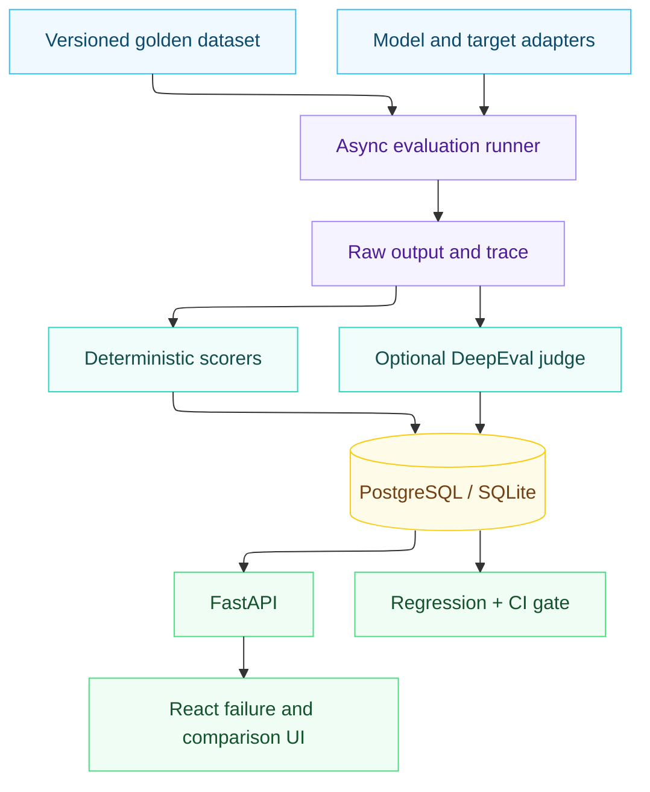

<div align="center">

# ⚖️ EvalBench

### Self-hosted LLM Regression & Quality Intelligence Platform


*Benchmark versioned product behavior · Combine deterministic checks with LLM-as-judge · Detect regressions with uncertainty intervals · Gate deployments through CI*

</div>

---

EvalBench is a self-hosted LLM product regression and quality-intelligence platform. It benchmarks versioned product behavior, preserves evidence for every case, combines deterministic checks with optional LLM judging, detects regressions with uncertainty intervals, and exposes the result to engineers and CI.

It is not a chatbot. The bundled SEC RAG service is a concrete product under test; EvalBench itself is target-agnostic.

> **Built an end-to-end LLM evaluation and regression platform** that benchmarks multiple model configurations against a versioned golden dataset, combines deterministic checks with LLM-as-judge evaluation, analyzes judge reliability, tracks quality/cost/latency trade-offs, detects regressions statistically, and enforces quality gates through GitHub Actions.

## What is implemented

- 75 authored SEC/company-filing QA cases spanning factual, retrieval, reasoning, citation, refusal, adversarial, formatting, and instruction-following behavior.
- Immutable dataset versions, SHA-256 checksums, schema validation, stats, and semantic diffs.
- OpenAI Responses, Anthropic Messages, Gemini generateContent, Ollama, external target API, and isolated offline-provider adapters.
- Bounded `asyncio` execution, timeout, exponential retry, cancellation hook, partial-result persistence, and resume-by-work-item.
- Exact, required/forbidden fact, regex, JSON schema, citation presence, and citation-validity scorers.
- DeepEval integration for G-Eval correctness/instruction following, answer relevance, and RAG faithfulness. It is optional because it requires a configured judge.
- Normalized traces, machine-readable failure labels, cost/token nullability, and provider-error capture.
- Bootstrap confidence intervals, absolute and relative changes, quality/latency/cost gates, and judge/human agreement metrics.
- FastAPI, normalized SQLAlchemy persistence, Alembic, Typer CLI, React/TypeScript/Tailwind UI, Docker Compose, and GitHub Actions.

No hosted-provider result, usage figure, latency, or cost is fabricated. An absent API key produces an unavailable state or explicit error. Offline runs carry `is_mock=true` and “Mock Provider / Offline Demo” labels. The mock tokenizer and its zero cost are part of that provider's declared contract.

## Architecture



The backend keeps dataset management, providers, execution, scoring, regression, persistence, API, and CLI separate. Provider output is normalized before scoring. `EvaluationResult`, `Score`, `Failure`, and `JudgeEvaluation` remain distinct so a raw response can be rescored without inventing a new execution.

## Quick start

Python 3.12+ and Node 22+ are recommended.

```bash
python -m venv .venv
# Windows: .venv\Scripts\activate
# macOS/Linux: source .venv/bin/activate
python -m pip install -e ".[test]"
python scripts/seed_demo.py
uvicorn app.main:app --app-dir backend --reload --port 8000
```

In a second terminal:

```bash
cd frontend
npm install
npm run dev
```

Open `http://localhost:5173`. API docs are at `http://localhost:8000/api/docs`.

Or start PostgreSQL, backend, target, and frontend together:

```bash
docker compose up --build
```

The UI is then at `http://localhost:8080`. Ollama is opt-in:

```bash
docker compose --profile local-model up --build
```

## Configuration

Copy `.env.example` to `.env`. Important variables:

| Variable | Purpose |
|---|---|
| `DATABASE_URL` | SQLite locally; PostgreSQL in Compose/production |
| `OPENAI_API_KEY`, `ANTHROPIC_API_KEY`, `GOOGLE_API_KEY` | Optional hosted providers |
| `OLLAMA_BASE_URL` | Local Ollama endpoint |
| `DEFAULT_MODEL` | Target RAG generator; extractive mode is used when unconfigured |
| `EVAL_CONCURRENCY` | Maximum in-flight calls |
| `EVAL_TIMEOUT`, `EVAL_RETRIES` | Execution bounds |
| `REGRESSION_THRESHOLD` | Default absolute pass-rate threshold |
| `CORS_ORIGINS` | Explicit browser origins |

Pricing lives in `configs/pricing.yaml` and configuration snapshots. Hosted entries are intentionally empty until an operator supplies current provider pricing. This returns `null`, never a guessed dollar value.

## Target SEC RAG product

The reference target uses a dependency-free BM25-style lexical retriever over 15 curated annual-filing excerpts. It calls an explicitly configured OpenAI/Ollama generator; otherwise it returns the retrieved excerpt and identifies itself as `extractive-local-v1`.

```bash
uvicorn target_app.api.main:app --reload --port 8001
curl -X POST http://localhost:8001/query -H "content-type: application/json" \
  -d '{"question":"What were AWS net sales in 2023?"}'
```

The response includes source IDs, quotes, retrieval scores, model/mode, observed latency, token fields where available, and a trace. The curated excerpts make the demo reproducible; a production team should replace them with legally reviewed source documents and domain-expert annotations.

## CLI

```bash
evalbench init
evalbench dataset validate datasets/golden_v1.json
evalbench dataset stats datasets/golden_v1.json
evalbench dataset diff datasets/golden_v1.json datasets/golden_v2.json
evalbench run --dataset datasets/golden_v1.json --models configs/models.yaml --model mock-baseline
evalbench compare BASELINE_RUN_ID CURRENT_RUN_ID
evalbench regressions BASELINE_RUN_ID CURRENT_RUN_ID
evalbench export RUN_ID --output artifacts/run.json
```

Use `target_api` in `configs/models.yaml` with `target_url: http://localhost:8001/query` to evaluate the RAG API or another compatible product.

## Reproducible demo

```bash
python scripts/seed_demo.py
python scripts/ci_gate.py
```

`seed_demo.py` executes all 75 cases twice. The candidate configuration deterministically omits evidence for a subset of IDs; scorers then calculate the degraded pass rate and failure distribution. Neither the rates nor gate decision are hardcoded. Generated run IDs and calculated metrics are written to `examples/demo_runs.json` and the database.

## API

- `GET /api/health`
- `POST /api/runs`; `GET /api/runs`; `GET /api/runs/{id}`
- `GET /api/runs/{id}/metrics`; `GET /api/runs/{id}/failures`
- `GET /api/models`; `GET /api/datasets`
- `GET /api/regressions`; `GET /api/comparisons`
- `GET /api/judge-reliability`

Run creation validates model names and dataset paths. Result rows are committed independently so successful calls survive partial provider outages.

## Judge methodology

Install the optional integration with `python -m pip install -e ".[judge]"`. EvalBench maps a case and preserved retrieval context into DeepEval test cases, then runs G-Eval, answer relevance, and faithfulness asynchronously. The separate native structured-rubric adapter supports any EvalBench provider.

The dataset marks a human-validation subset in case metadata. Reliability reporting includes exact agreement, disagreement rate, mean absolute error, Pearson correlation where defined, a 1–5 confusion matrix, Cohen's kappa, and mean bias. Fewer than 30 pairs is explicitly flagged as insufficient for significance claims. Judge agreement is evidence about consistency with these raters—not proof that the judge or human label is correct.

## Regression methodology

The pass-rate comparison reports the observed percentage-point change, relative change, and a deterministic non-parametric 95% bootstrap interval. Classification is intentionally conservative:

- `regression_detected`: operational threshold crossed and interval below zero.
- `possible_regression`: threshold crossed but uncertainty includes zero.
- `inconclusive`: no material threshold crossing and interval includes zero.
- `improvement`: positive threshold crossed and interval above zero.
- `no_material_change`: remaining cases.

Bootstrap intervals describe sampling uncertainty for the evaluated case set. They do not prove causality, correct dataset bias, or make small per-category samples representative.

## CI integration

`.github/workflows/evalbench.yml` installs the project, runs tests, executes the offline baseline/candidate matrix, applies `configs/regression.yaml`, and uploads JUnit plus `quality-gate.json`. `scripts/ci_gate.py` exits `1` on a failed gate, `2` when runs are missing, and supports `--warn-only`.

For a product repository, replace the demo candidate with the deployed target/configuration and provide a promoted baseline run from durable storage. Do not treat the bundled mock baseline as production evidence.

## Security and observability

Secrets are environment-only, sensitive log fields are redacted, request sizes and inputs are bounded, CORS is explicit, and dataset extensions/paths are validated. JSON evaluation logs include run, case, provider, model, timing, and error state. These are baseline controls, not an enterprise-security claim.

## Verification

```bash
pytest
cd frontend && npm run build
alembic upgrade head
```

The tests cover scoring, dataset validation/diffing, bootstrap regression classification, judge reliability statistics, provider failure behavior, async persistence, API validation, and CI gate decisions.

## Limitations and next work

- The bundled excerpts are compact demo evidence, not a full SEC ingestion pipeline.
- Statistical intervals assume the case set is a meaningful sample; category balance still requires expert review.
- Provider token accounting differs. Missing usage remains `null`; Ollama/local dollar cost excludes infrastructure.
- Judge calibration requires real human ratings and a configured judge before the reliability page can support decisions.
- Production deployments should add authentication, object storage for large traces, retention policies, and background job ownership.

## 👤 Author

Jay Patel
---

